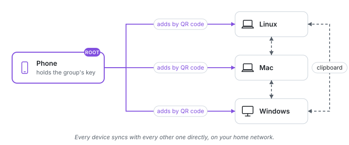

# Copy Beyond Borders

[](https://securityscorecards.dev/viewer/?uri=github.com/HunterEwok/cbb)
[](https://api.reuse.software/info/github.com/HunterEwok/cbb)

**One encrypted clipboard for all your devices, with no cloud.**

Copy on your phone, paste on your laptop: Copy Beyond Borders takes the borders between your
devices away. Android, iPhone, Linux, Windows and Mac share one clipboard, encrypted end to
end, with no accounts and nothing kept in a cloud. Its short name is CBB and its command is
`cbb`.

> **Status: early development.** Tried on real devices so far: Linux computers, a Mac, an
> iPhone and an Apple Watch; Windows only in a virtual machine, Android only in CI's emulator.
> [Status](#status) has more.



## Get started

1. Install the app on your phone (Android: the APK in the
   [latest release](https://github.com/HunterEwok/cbb/releases/latest); iPhone:
   TestFlight, coming).
2. Install Copy Beyond Borders on a computer:

   ```sh
   # Linux and Mac
   curl -fsSL https://github.com/HunterEwok/cbb/releases/latest/download/get.sh | sudo sh
   ```

   ```powershell
   # Windows 10 or 11, in an administrator PowerShell
   irm https://github.com/HunterEwok/cbb/releases/latest/download/get.ps1 | iex
   ```

3. Run `sudo cbb pair` on the computer and scan its QR code in the app. Its copies then go
   to the group and the group's come to it; `cbb sync off` keeps its clipboard its own.

To check the installer before running it, download it with the release's `SHA256SUMS`:

```sh
v=https://github.com/HunterEwok/cbb/releases/latest/download
curl -fsSLO "$v/get.sh" && curl -fsSLO "$v/SHA256SUMS"
grep ' get.sh$' SHA256SUMS | sha256sum -c - && sudo sh get.sh
```

On a Mac, `shasum -a 256 -c -` takes the place of `sha256sum -c -`. The installer then checks
everything it downloads against the same file ([checking a download](docs/guide/install.md#checking-a-download)).

No computer? A group of phones only works too: the phone is the hub while its app is open.
We recommend a computer that is often on, though, since it keeps sync away from home going at
any time ([two kinds of group](docs/guide/how-it-works.md#two-kinds-of-group)).

The [quick start](docs/guide/quickstart.md) walks through it step by step;
[Installing](docs/guide/install.md) has Homebrew, Docker, the firewall, the
[ports](docs/reference/devices.md#ports) and [removing it](docs/guide/install.md#removing-it).

## What it does

| From → to | What you do |
|---|---|
| Computer → computer | Copy on one, paste on another. Automatic. |
| Computer → Android | Copy on the computer, paste on the phone. Automatic. |
| Android → computer | Copy on the phone; sent by itself with the accessibility service, or with one tap. |
| Computer ↔ iPhone | One press of the Action button or a double tap on the back, then paste. |

iOS does not let apps read the clipboard in the background, so the iPhone needs one
gesture. Apple devices on one Apple Account already share a clipboard; Copy Beyond Borders
connects them to everything else. On Linux it works with X11 and Wayland desktops, and without one
through tmux and `cbb copy` and `cbb paste`.

It also does:

- **Away from home**: your devices keep one clipboard through a computer of yours at home,
  still encrypted end to end ([away from home](docs/guide/away-from-home.md)).
- **Images, files and formatted text**, not only plain text
  ([images and files](docs/guide/images-and-files.md)).
- **Remote paste** from the phone or the watch into the window in front on a computer, and
  **quick actions** such as locking its screen ([remote paste](docs/guide/remote-paste.md),
  [quick actions](docs/guide/quick-actions.md)).
- **Watches**: the Apple Watch and Wear OS show the group and send a remote paste.

The [lab](docs/guide/lab.md) has the experiments: keyboards and TV remotes that type a text
for you, the Arduino Nano ESP32 and the ZX Spectrum Next.

## Principles

- **Your devices only.** At home the devices talk to each other directly. Away from home
  they reach a computer of yours at home ([how it works](docs/guide/how-it-works.md)). No
  cloud, no accounts, no telemetry.
- **Encrypted end to end.** Every copy, its text, images and files, is sealed on the device
  that makes it, for the devices of your group that read copies, and signed by it. Whatever
  carries it on the way, a hub, a forwarder or a relay, can neither read it, change it nor
  forge one ([who can read what](#who-can-read-what)).
- **Encrypted and paired.** The devices talk to each other only over TLS 1.3 with the
  group's own certificates; what is not encrypted (mDNS on the home network, a Roku's text) is
  in [privacy](docs/guide/privacy.md). A device joins your group once, by a QR code or a
  six-digit code, and talks only to the devices of the group.
- **The key stays on the phone.** In a group made on a phone, the phone holds the group's
  root key in its security chip and admits every device; each signature with it asks for your
  face, fingerprint or passcode.
- **Small.** One file per platform, no dependencies; runs on a Raspberry Pi Zero W.
- **Passwords stay put.** Items that password managers mark as secret are not synced
  automatically.

## Who can read what

| | Holds | Can read your copies | Can admit or remove devices |
|---|---|---|---|
| The **root** (the phone or computer that made the group) | the group's root key, in its security chip where it has one | yes | yes, and makes admins |
| An **admin** (a phone or computer the root chose) | an admin key under the root | yes | yes |
| Every other device of the group, a **hub that reads the copies** included | its own member key and certificate | yes | no |
| A **hub that only passes copies on** (any computer of yours, a Raspberry Pi say) | its own member key and certificate | no: no copy is sealed to it | no |
| A **forwarder** (yours, or the project's at `cbb.tools`) | no group key | no: it sees the addresses, timing and sizes of encrypted packets | no |
| A **blind relay** | no group key | no: it sees which devices of a group are online and talk, when and how much | no |

The clipboard is encrypted end to end. The device that copies seals each copy with a key of
its own, wraps that key for every device of the group that reads copies (X-Wing, a
post-quantum hybrid) and signs the whole with its member key. Everything in between passes the
sealed copy on as it is: a hub that only passes copies on, a forwarder and a blind relay never
hold a key that opens it, and no device can alter a copy or make one in another's name.
What passing a copy on needs stays visible to the devices it crosses: which device sent it,
when, to which devices, and its size in steps; never its kind, its text, its files' names or
their number ([privacy](docs/guide/privacy.md#what-the-devices-in-between-see)). Commands (a
remote paste, a quick action) are sealed to the one device they are for. The six-digit
pairing code, or the QR code that carries it, is the only secret a person handles: show it
only to the device that should join, as anyone who has it during the pairing can join. The
details: [privacy](docs/guide/privacy.md), [keys and attestation](docs/guide/keys.md) and
the [threat model](docs/threat-model.md).

## Compared with similar tools

- [KDE Connect](https://apps.kde.org/kdeconnect) shares the clipboard among Linux, Android,
  iOS, macOS and Windows, with much more besides (notifications, files, media control). It
  pairs devices two by two; Copy Beyond Borders keeps one group with a root key in the
  phone's security chip, syncs away from home through a computer of yours, and does only
  the clipboard and what goes with it.
- [ClipCascade](https://github.com/Sathvik-Rao/ClipCascade) syncs the clipboard of Windows,
  macOS, Linux and Android, encrypted end to end, through a server you run or a community
  server with an account, or peer to peer. Copy Beyond Borders needs no server and no
  account at home, and has an iPhone app.
- Apple's Universal Clipboard works between Apple devices on one Apple Account only.

Where Copy Beyond Borders is weaker: the iPhone needs one gesture for each copy, since iOS
lets no app read the clipboard in the background; a device that joins the group reads
copies from the next one on, not the copies made before it; it is early software, with
Android and Windows not yet tried on real devices.

## Platforms

| Platform | Component |
|---|---|
| Linux: Ubuntu, Raspberry Pi OS and other distributions; x86-64, ARM64, ARMv7, ARMv6 | service, desktop connector, console helper, tray app |
| macOS | service, pasteboard agent, Mac app |
| Windows 10 (1809 or later) and 11; x86-64, ARM64 | service, clipboard agent, tray app |
| FreeBSD 15; x86-64, ARM64 | service |
| OpenWrt 25.12 and later; ARM64, ARMv7, MIPS, x86-64 | service, as an always-on member and the hub |
| Android | the app (an APK in every release) |
| iOS and iPadOS | the app |
| Apple Watch, Wear OS | a watch app, through the phone |
| Small Linux devices (routers, boards) | the same `cbb`, without its helper ([member/README.md](member/README.md)) |

## Status

- **Tried on real devices**: the service on Linux and macOS, the iPhone app with the phone
  as the root, the Mac app and the Apple Watch app, sync away from home through a Mac hub.
- **Built and tested in CI**, not yet on real devices: Windows (in a virtual machine),
  Android, FreeBSD, OpenWrt, the tray app on Linux.
- **Waiting for the project's keys and the Apple developer account**: signed releases and
  `cbb update`, TestFlight and the signed macOS package; app stores are planned.

Every part, and where it has run: [on real devices](docs/parity.md#on-real-devices).
The order of what comes next is the [roadmap](docs/roadmap.md).

## Documentation

- **Using it**: the [quick start](docs/guide/quickstart.md), [how it works](docs/guide/how-it-works.md)
  (with pictures), [installing](docs/guide/install.md), [away from home](docs/guide/away-from-home.md),
  [networks that block VPNs](docs/guide/blocked-networks.md), [keys and attestation](docs/guide/keys.md),
  [images and files](docs/guide/images-and-files.md), [remote paste](docs/guide/remote-paste.md),
  [quick actions](docs/guide/quick-actions.md), [the apps](docs/guide/apps.md),
  [the lab](docs/guide/lab.md),
  [without the app](docs/guide/without-app.md), [a lost device](docs/guide/lost-device.md) and
  [troubleshooting](docs/guide/troubleshooting.md).
- **Running servers**: [your own forwarder or relay](docs/admin/self-hosting.md), the
  [Docker image](packaging/docker/README.md), [`cbb` on small devices](member/README.md).
- **Reference**: [commands](docs/reference/cli.md), [settings and environment variables](docs/reference/config.md),
  [devices, ports and files](docs/reference/devices.md), the [glossary](docs/reference/glossary.md).
- **For developers**: the [design](docs/design.md), the [protocol](docs/protocol.md) and the
  rest in the [documentation index](docs/README.md).

## License

Copy Beyond Borders is free software, licensed under the
[GNU Affero General Public License v3.0 only](LICENSE).

One author holds all the rights, so a commercial license without the AGPL's obligations is
also available, for example to build `cbb` (`member/`) into routers and other
devices. To ask for one, open an issue with the **Commercial license** form on
[GitHub](https://github.com/HunterEwok/cbb/issues/new/choose).

Which builds are official, what others may do with the icon and the name, and the other
projects with similar names: [BRAND.md](BRAND.md). The text of the protocol,
[docs/protocol.md](docs/protocol.md), is under
[CC BY 4.0](https://creativecommons.org/licenses/by/4.0/), so anyone may write a compatible
implementation.

## Security

- What each device and server can see: [Who can read what](#who-can-read-what) above and
  [privacy](docs/guide/privacy.md).
- The attacks it defends against and those it does not: the [threat model](docs/threat-model.md);
  the cryptography in one place: [cryptography](docs/cryptography.md).
- The plan of the security audits: [security audit](docs/maintainers/security-audit.md).

To report a vulnerability, follow [SECURITY.md](SECURITY.md). Please do not open a public issue.

## How it is built

The author directs the work, makes the decisions, runs the security audits and tests on real
devices; most of the code and documentation is written with AI coding tools (Claude Code),
under that direction and the project's tests in CI.

## Contributing

Bug reports and ideas are welcome as issues. Code contributions are not accepted at this time;
see [CONTRIBUTING.md](CONTRIBUTING.md).
