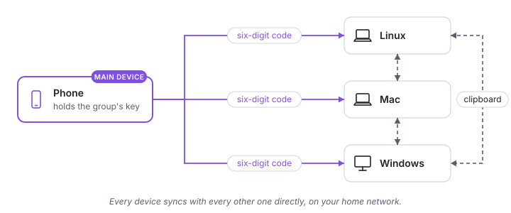

# Connect Beyond Borders

[](https://scorecard.dev/viewer/?uri=github.com/HunterEwok/cbb)
[](https://api.reuse.software/info/github.com/HunterEwok/cbb)
[](https://www.bestpractices.dev/projects/17052)

**One encrypted clipboard for all your devices, with no cloud.**

Connect Beyond Borders shares one end-to-end encrypted clipboard across your own phones, computers,
and small devices with no account, no cloud service, and no central server. Copy on your phone and
paste on your laptop across Android, iPhone, Aurora OS, HarmonyOS, Linux, macOS, Windows, FreeBSD,
and OpenWrt. Its short name is CBB and its command-line tool is `cbb`.

> **Early development.** Tested on real hardware: Linux computers, macOS, iPhone, Apple Watch,
> Aurora OS, and a Raspberry Pi Zero W. Windows is tested in a virtual machine, and Android,
> HarmonyOS, FreeBSD, and OpenWrt are tested in CI. See [Status](#status).



## Get started

1. **Install the phone app.** Download the Android APK from the
   [latest release](https://github.com/HunterEwok/cbb/releases/latest), or see
   [The apps](docs/guide/apps.md) for iPhone, Aurora OS, Sailfish OS, and HarmonyOS.
2. **Install Connect Beyond Borders on a computer:**

   ```sh
   # Linux, macOS, FreeBSD, and OpenWrt
   curl -fsSL https://github.com/HunterEwok/cbb/releases/latest/download/get.sh | sudo sh
   ```

   ```powershell
   # Windows 10 (1809+) or 11, in an administrator PowerShell
   irm https://github.com/HunterEwok/cbb/releases/latest/download/get.ps1 | iex
   ```

   To verify the installer checksum before running it:

   ```sh
   v=https://github.com/HunterEwok/cbb/releases/latest/download
   curl -fsSLO "$v/get.sh" && curl -fsSLO "$v/SHA256SUMS"
   grep ' get.sh$' SHA256SUMS | sha256sum -c - && sudo sh get.sh
   ```

   On macOS, replace `sha256sum -c -` with `shasum -a 256 -c -`. The installer verifies every file
   it downloads against `SHA256SUMS` and the release signatures
   ([Checking a download](docs/guide/install.md#checking-a-download)).

3. **Pair your computer with your group.** Tap **+** (**Add a device**) in the phone app, run
   `sudo cbb pair -code` on the computer, and enter the six-digit code the app displays. Copies
   then sync both ways; run `cbb sync off` to keep that computer's clipboard private.

You can also create a group of phones alone (meeting through a blind relay) or run a group held by
a computer without a phone app. Adding a computer that stays on gives you direct local syncing and
away-from-home syncing at any time ([Two kinds of group](docs/guide/how-it-works.md#two-kinds-of-group)).

For a step-by-step walkthrough, read [Quick start](docs/guide/quickstart.md). For Homebrew, winget,
Docker, firewall rules, ports, and uninstalling, see [Installing](docs/guide/install.md) and
[Devices, ports and files](docs/reference/devices.md#ports).

## What it does

| Direction | How it works |
|---|---|
| Computer ↔ computer | Copy on one computer, paste on another automatically. |
| Computer → Android | Copy on the computer, paste on the phone automatically. |
| Android → computer | Copy on the phone; sends automatically with the accessibility service, or with one tap. |
| Computer ↔ iPhone | Press the Action button or double-tap the back (or open the app), then paste. |
| Computer ↔ Aurora OS / HarmonyOS | Open the app to sync, or use **Share → Connect Beyond Borders**. |

iOS restricts background clipboard access, so an iPhone requires one gesture or opening the app to
sync. On Linux, `cbb` supports X11 and Wayland desktops as well as headless machines through `tmux`,
`cbb copy`, and `cbb paste`.

Additional capabilities:

- **Away from home**: Keep syncing outside your home network through a computer or small board at
  home acting as a **hub**, or through a **blind relay** ([Away from home](docs/guide/away-from-home.md)).
- **Images, files, and formatted text**: Sync images, files, folders, and HTML up to per-device
  size limits ([Images, files and formatted text](docs/guide/images-and-files.md)).
- **Remote paste and quick actions**: Paste from an admin device into the focused window on a
  computer, or run user-approved actions such as locking the screen
  ([Remote paste](docs/guide/remote-paste.md), [Quick actions](docs/guide/quick-actions.md)).
- **Watches**: Apple Watch, Wear OS, and HarmonyOS watch apps display online devices, recent group
  events, and **Sync** / **Everywhere** controls through the paired phone ([The apps](docs/guide/apps.md)).
- **The lab**: Experimental features including Bluetooth and USB keyboards, network TV remotes,
  Arduino Nano ESP32 firmware, and ZX Spectrum Next support ([The lab](docs/guide/lab.md)).

## Principles

- **Your devices only.** At home, devices discover each other on your local network and connect
  directly. Away from home, they connect through your own hub
  ([How it works](docs/guide/how-it-works.md)). No cloud, no accounts, and no telemetry.
- **End-to-end encrypted.** Every copy—text, images, and files—is sealed on the copying device for
  only the reading devices in your group and signed with the sender's key. Hubs that only pass
  copies on, forwarders, and blind relays cannot read, modify, or forge copies
  ([Who can read what](#who-can-read-what)).
- **Verified peer connections.** Devices communicate over mutual TLS 1.3 and verify each peer's key
  against the group's signed device records. A device joins once using a QR code or six-digit code.
- **Hardware-backed main key.** In a group created on a phone, the phone stores the group's main
  key in security hardware and requires your face, fingerprint, passcode, or (on Aurora OS) app PIN
  before signing admin changes.
- **Small footprint.** Self-contained binaries with no runtime dependencies; runs on a Raspberry Pi
  Zero W or OpenWrt router.
- **Password protection.** Items marked as secret by password managers are skipped automatically.

## Who can read what

| Role or server | Keys held | Can read copies | Can admit or remove devices |
|---|---|---|---|
| **Main device** (*root*) | Group root key (in security hardware where available) | Yes | Yes, and chooses admins |
| **Admin** | Admin key authorized by the main device | Yes | Yes |
| **Member** (including a **hub that reads copies**) | Own member key | Yes | No |
| **Hub that only passes copies on** | Own member key | No (no copy is sealed to it) | No |
| **Forwarder** (yours, or the project's at `cbb.tools`) | No group key | No (sees encrypted packet addresses, timing, and sizes) | No |
| **Blind relay** | No group key | No (sees temporary pseudonyms online together, addresses, timing, and volume) | No |

Each copy is encrypted with a fresh random key wrapped for each reading device using X-Wing
(a post-quantum hybrid KEM) and signed with the sender's member key. Intermediaries forward the
sealed bytes unchanged: they see only which device sent a copy, when, to which devices, and its
rounded size—never its type, text, or file names
([Privacy: who sees what](docs/guide/privacy.md#what-the-devices-in-between-see)). Admin commands
(remote paste and quick actions) are sealed to their target device. Keep the six-digit pairing code
and QR code private, as anyone who sees them during the pairing window can join. For details, see
[Privacy: who sees what](docs/guide/privacy.md), [Keys and attestation](docs/guide/keys.md), and
[Threat model](docs/threat-model.md).

## Compared with similar tools

- [KDE Connect](https://apps.kde.org/kdeconnect) shares clipboards across Linux, Android, iOS,
  macOS, and Windows along with notifications and media controls, pairing devices two by two.
  Connect Beyond Borders focuses on clipboard sharing across one signed device group, keeps the
  main key in phone security hardware, and syncs away from home through your own hub.
- [ClipCascade](https://github.com/Sathvik-Rao/ClipCascade) syncs clipboards across Windows, macOS,
  Linux, and Android with end-to-end encryption through a server or peer to peer. Connect Beyond
  Borders needs no server or account at home and includes native iPhone, Aurora OS, and HarmonyOS
  apps.
- Apple Universal Clipboard works only between Apple devices signed in to the same Apple Account.

**Current trade-offs:** iPhone syncing requires one gesture or opening the app because iOS blocks
background clipboard access; newly joined devices read only copies made after they join; and
Connect Beyond Borders is early software not yet tested on every hardware platform.

## Platforms

| Platform | Components |
|---|---|
| Linux (x86-64, ARM64, ARMv7, ARMv6) | Service (`cbb`), helper (`cbb-helper`), desktop agent, console helper, tray app |
| macOS (14 or later) | Service, pasteboard agent, Mac menu bar app |
| Windows 10 (1809+) and 11 (x86-64, ARM64) | Service, clipboard agent, tray app |
| FreeBSD 15 and OPNsense (x86-64, ARM64) | Service |
| OpenWrt 25.12+ (ARM64, ARMv7, MIPS, x86-64) | Service (always-on member; hub on non-MIPS builds) |
| Android (10+) and Android TV | Native app (full APK and reproducible F-Droid APK) |
| iOS and iPadOS (17+) | Native app |
| Aurora OS (4, 5.1.5) and Sailfish OS (4.6) | Native Silica app (`apps/silica`) |
| HarmonyOS (5+) | Native ArkUI app (`apps/harmony`) |
| Apple Watch, Wear OS, HarmonyOS watch | Companion watch app (through the paired phone) |
| Small Linux devices (routers, boards) | `cbb` without `cbb-helper` ([Small devices](member/README.md)) |

## Status

- **Tested on real devices:** Linux computers (including Raspberry Pi and Steam Deck), macOS
  service and Mac app, iPhone app as main device (Secure Enclave and Face ID), Apple Watch app,
  Aurora OS 5.1.5 app (on an F+ R570E), Raspberry Pi Zero W without helper, away-from-home phone
  sync through a Mac hub and the `cbb.tools` forwarder, remote paste from iPhone to Mac, and
  typing on an Apple TV 4K.
- **Built and tested in CI (not yet on physical hardware):** Windows (tested in an Arm Windows 11
  virtual machine), Android (CI emulator), HarmonyOS, FreeBSD, OpenWrt, Sailfish OS, Linux tray
  app, Wear OS, and ESP32 firmware.

For the full component-by-component breakdown, see [On real devices](docs/parity.md#on-real-devices).
For planned features and upcoming release work, see [Roadmap](docs/roadmap.md).

## Documentation

- **User guides:** [Quick start](docs/guide/quickstart.md), [How it works](docs/guide/how-it-works.md),
  [Installing](docs/guide/install.md), [The apps](docs/guide/apps.md),
  [Away from home](docs/guide/away-from-home.md),
  [Networks that block VPNs](docs/guide/blocked-networks.md),
  [Images, files and formatted text](docs/guide/images-and-files.md),
  [Remote paste](docs/guide/remote-paste.md), [Quick actions](docs/guide/quick-actions.md),
  [Keys and attestation](docs/guide/keys.md),
  [If a device is lost or stolen](docs/guide/lost-device.md),
  [Without the app](docs/guide/without-app.md), [The lab](docs/guide/lab.md), and
  [Troubleshooting](docs/guide/troubleshooting.md).
- **Administrators:** [Running your own servers](docs/admin/self-hosting.md),
  [Upgrades and backups](docs/admin/upgrade-and-backup.md),
  [Routers and FreeBSD](docs/admin/routers.md), [Hardening](docs/admin/hardening.md),
  [Docker image](packaging/docker/README.md), and [Small devices](member/README.md).
- **Reference:** [Command reference](docs/reference/cli.md),
  [Settings and environment variables](docs/reference/config.md),
  [Devices, ports and files](docs/reference/devices.md),
  [Limits and lifetimes](docs/reference/limits.md), and [Glossary](docs/reference/glossary.md).
- **Engineers:** [Design](docs/design.md), [Protocol](docs/protocol.md), and the full
  [Documentation index](docs/README.md).

## Security

- **Privacy and exposure:** [Who can read what](#who-can-read-what) and
  [Privacy: who sees what](docs/guide/privacy.md).
- **Security analysis:** [Threat model](docs/threat-model.md),
  [Cryptography](docs/cryptography.md), and [Security audit](docs/maintainers/security-audit.md).
- **Reporting vulnerabilities:** Follow [SECURITY.md](SECURITY.md). Do not open a public issue.

## License

Connect Beyond Borders is free software licensed under the
[GNU Affero General Public License v3.0 only](LICENSE).

Because one author holds all rights, a commercial license without AGPL obligations is also
available (for example, to embed `cbb` into routers or appliances). To request one, open an issue
using the **Commercial license** form on
[GitHub](https://github.com/HunterEwok/cbb/issues/new/choose).

For official builds, trademark rules, and icon usage, see [BRAND.md](BRAND.md). The protocol
specification ([docs/protocol.md](docs/protocol.md)) is licensed under
[CC BY 4.0](https://creativecommons.org/licenses/by/4.0/) so anyone can write a compatible
implementation.

## Contributing

Bug reports and feature ideas are welcome through GitHub issues. Pull requests are not accepted at
this time; see [CONTRIBUTING.md](CONTRIBUTING.md).
