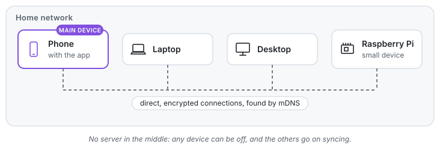
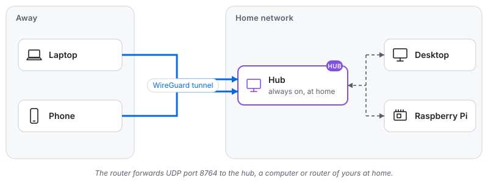
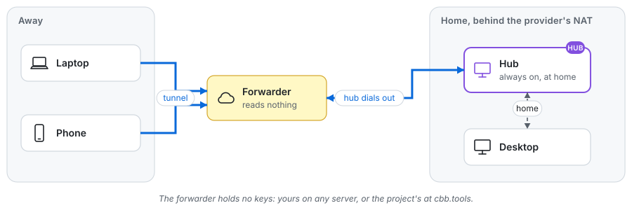
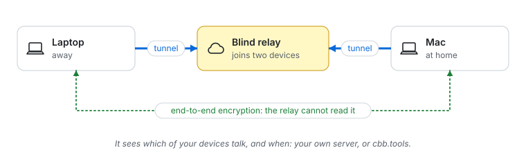

<!-- SPDX-License-Identifier: AGPL-3.0-only -->
# How it works

For anyone who wants to understand what happens to their copies and how Connect Beyond Borders
connects their devices. Connect Beyond Borders shares one clipboard across your own devices
without an account, a cloud service, or a central server.

For setup steps, see [Quick start](quickstart.md). For engineering details and the wire format,
see [Design](../design.md) and [Protocol](../protocol.md).

## What happens when you copy

When you copy text, an image, or files on one device, Connect Beyond Borders encrypts the copy
for your other devices and sends it across your home network—or through your group's encrypted
tunnel when you are away from home.

How each device sends and receives copies depends on what its operating system allows:

- **Computers and small devices**: Copying sends the copy to your group automatically, and
  incoming copies enter your clipboard automatically while **Sync** is on.
- **Android phones**: The app receives copies in the background automatically. To send copies,
  you can turn on its accessibility service for automatic sending, or tap the app's sync button.
- **iPhone, Aurora OS, and HarmonyOS phones**: Mobile operating systems restrict clipboard
  access in the background. While the app is open on screen, it listens automatically like a
  computer. When you use the sync button or gesture (such as the Action button or Back Tap on an
  iPhone), the phone swaps its clipboard with the group's latest copy. If your phone's clipboard
  is empty, it receives the group's copy without overwriting it.

Connect Beyond Borders protects every copy in layers:

- **End-to-end encryption**: Before a copy leaves the device where you copied it, that device
  encrypts (seals) the copy for only the devices in your group that read copies and signs it
  with its own key. The sealed copy travels inside an encrypted connection (TLS 1.3) where both
  devices verify each other's keys. Devices that only pass copies on, and any servers outside
  your group, cannot read, alter, or forge a copy.
- **Text, images, and files**: Plain text travels directly inside the sync message. When you
  copy an image, files, or formatted text, the copying device sends a short notice first; each
  receiving device fetches the sealed content up to its own size limit. See
  [Images, files and formatted text](images-and-files.md) and
  [Limits and lifetimes](../reference/limits.md#copies).
- **Passwords and secrets**: Connect Beyond Borders skips items that a password manager marks as
  secret. Secrets that you send deliberately stay in memory only, expire after a short lifetime
  (60 seconds by default), and clear from clipboards when their time ends.
- **No clipboard history**: Connect Beyond Borders keeps no history of past copies. Every copy
  carries a group-wide lifetime (5 minutes by default for ordinary copies, and 60 seconds for
  secrets). Once that time passes, devices stop writing the copy to clipboards.
- **Pausing sync**: Each device has a **Sync** switch. Turning **Sync** off keeps your clipboard
  private to that device while the device stays connected to the group. An admin can also mute a
  device whose clipboard misbehaves.

## The group

Your devices form a **group** that shares one clipboard. Every device keeps a copy of the
group's signed device records, which list every device in the group, its role, and any removed
devices. Because every device verifies these signed records itself, your group needs no central
server.

A group belongs to one person. Two people who want separate clipboards create two groups.

Only devices that you admit with a pairing code or QR code can join your group. If you lose a
device, removing it spreads a signed removal record so every other device refuses it at once.
See [If a device is lost](lost-device.md).

Each device has a role in the group:

| Role | Which devices | What it does |
|---|---|---|
| **Main device** (called *root* in command-line tools and diagrams) | The phone that creates the group, or a computer when you run [without the app](without-app.md) | Holds the group's main key, adds and removes devices, chooses admins, and sets group rules |
| **Admin** | Another phone or a computer chosen by the main device | Adds and removes ordinary devices, freezes a stolen admin computer, and sends admin actions such as [remote paste](remote-paste.md); an admin phone can also remove another admin |
| **Member** | Every computer, phone, and small device (such as a router or Raspberry Pi; see [small devices](../../member/README.md)) | Syncs the clipboard |
| **Rootless member** | A Linux computer installed without administrator rights (`sudo`) | Syncs like any member, but cannot be the main device, an admin, or a hub ([rootless members](#rootless-members)) |
| **Hub** | A computer, router, or small board at home | Connects your devices when they are away from home; a hub that only passes copies on reads none |

A paired Apple Watch, Wear OS watch, or HarmonyOS watch works through its phone to show the
group's devices and toggle syncing away from home; see [The apps](apps.md).

Where a device keeps its keys determines what a thief can take if the device is stolen:

- **Phones** create their keys inside security hardware—the Secure Enclave on an iPhone, the
  Android Keystore (StrongBox or TEE), the secure element on Aurora OS, or HUKS on
  HarmonyOS—where the keys stay. Signing an admin change asks for your face, fingerprint,
  passcode, or (on Aurora OS) the app's own PIN; everyday syncing works without asking.
- **Computers** keep their member and admin keys in hardware when available: the Secure Enclave
  on Macs with Apple silicon or a T2 chip, and the hardware security chip (TPM) on Linux and
  Windows PCs. Computers without that hardware, small devices, and a computer acting as the
  main device keep keys in files that only Connect Beyond Borders can read.

For full details on key storage and verification, see [Keys and attestation](keys.md).

### Rootless members

A normal Linux install asks for administrator rights (`sudo`) once so Connect Beyond Borders can
run under its own system account in a tight sandbox. That separation keeps your browser, games,
and other programs from reading your device's keys.

On a Linux computer where you do not have `sudo` (such as a work computer), a rootless install
runs under your own user account. It syncs like any member, but any program you run can copy its
key files and impersonate that device. For that reason, a rootless member can never be the main
device, an admin, or a hub. The device list labels it **Member, rootless**.

A Steam Deck supports a normal install because its user has `sudo`; see
[Installing on SteamOS](install.md#steamos-steam-deck).

## Two kinds of group

A group can include at least one computer or small device, or it can consist of phones alone.
Both setups work, and you can add a computer to a phones-only group at any time.

| | With a computer or small device | Phones only |
|---|---|---|
| Main device | A phone (in its security hardware), or a computer [without the app](without-app.md) | A phone (in its security hardware) |
| Sync at home | Direct encrypted connections on your home network | Through a blind relay while the apps run |
| Sync away from home | Through a computer or small device acting as a hub | Through a blind relay while the apps run |
| Extra device needed | A computer, router, or small board | None |

Phones only open outgoing connections because mobile operating systems do not let apps wait in
the background for incoming connections. Computers and small devices listen for incoming
connections.

Adding a computer that stays on—such as a desktop, home server, router, or Raspberry Pi—gives
you direct local syncing with no server at all. You can also make that computer a hub from its
device page in the app so syncing away from home works even when phone apps are closed.

## At home

On one home network, your devices find each other automatically through local network discovery
(mDNS) and connect directly over encrypted TLS 1.3 connections. Nothing leaves your network, and
no server sits between your devices. You can turn off any device while the remaining devices
keep syncing.

Direct home syncing requires at least one computer or small device on the network, because
phones only start outgoing connections.

**Known home networks**: Computers remember the home networks where they meet your group
(identified by the network and its router). On an unfamiliar network, such as café or hotel
Wi-Fi, a computer stays quiet: it does not announce itself on the local network or accept
incoming connections.

**Separate networks at home**: Local network discovery (mDNS) does not cross routers between
separate local networks, such as a dedicated network for smart devices. You can join two home
networks in three ways:

- Run Connect Beyond Borders on a router connected to both networks.
- Give a computer or small device the address of a computer on the other network
  ([small devices](../../member/README.md#install)).
- Connect both networks through a hub ([away from home](#away-from-home-the-hub)).

## Away from home: the hub

When a laptop or phone leaves your home network, it cannot find your home devices through local
discovery. To keep syncing, one of your computers, routers, or small boards at home acts as a
**hub**: your away devices connect back to it through your group's own encrypted tunnel
(WireGuard), and the hub passes copies between them and the devices at home.

Inside the WireGuard tunnel, devices run the same mutual TLS connections and end-to-end sealed
copies they use at home. The tunnel runs inside Connect Beyond Borders itself: it carries only
Connect Beyond Borders traffic and does not take your phone's VPN slot, so your own VPN
continues working.

You can choose between two kinds of hub:

- **A hub that reads the copies**: Your main device (if it is a computer) or an admin computer.
  Your devices seal copies to it like to any other reading device, and your group's
  [key level](keys.md#the-three-levels) applies to its keys.
- **A hub that only passes copies on**: An ordinary computer or small board (such as a Raspberry
  Pi or a NAS) that your main device chooses. Your devices seal copies end to end past it, so
  it reads none, makes no copies of its own, and needs no hardware security chip.

Key properties of a hub:

- **Reaching the hub directly**: Your router forwards one UDP port (8764 by default) to the hub,
  or your home provides direct IPv6 access.
- **When the hub is off**: Away syncing pauses while the hub is off, and devices at home keep
  syncing directly without it.
- **Setup at home**: Devices exchange tunnel keys with the hub while on your home network, so
  turn **Everywhere** (sync away from home) on before you leave.
- **Multiple hubs**: A group can have several hubs in a fixed priority order. Only the
  highest-priority online hub serves at a time; standby hubs wait with no tunnel and take over
  automatically if the active hub stops or goes offline for more than a minute.

For setup steps, see [Away from home](away-from-home.md).

## Behind provider NAT: a forwarder

Many internet providers place homes behind a shared public address (carrier-grade NAT), which
prevents incoming connections from reaching your home even with port forwarding. In that case,
your hub registers with a **forwarder**—a server on the internet that relays encrypted tunnel
packets between your away devices and your hub. Because your hub opens an outgoing connection to
the forwarder, you do not open any port on your router.

A forwarder holds no group keys and cannot read your clipboard. It forwards encrypted WireGuard
packets between your away devices and your hub.

You can use either of two forwarders:

- **Your own forwarder** on any server with a public address, such as a small virtual server
  ([Running your own servers](../admin/self-hosting.md#a-forwarder)).
- **The project's forwarder** at `cbb.tools`, whose address and key are built into Connect
  Beyond Borders and kept current through signed lists.

Devices try your hub's direct addresses first and use the forwarder only when direct connections
do not answer.

## Networks that block VPNs

Some hotel and office Wi-Fi networks, mobile operators, and countries block standard WireGuard
traffic. By default, a hub disguises its tunnel so connections get through:

- **AmneziaWG**: Randomizes packet headers and adds padding so the tunnel does not look like
  WireGuard on the wire.
- **VLESS** (when using a forwarder): Carries the disguised tunnel inside what looks like an
  ordinary HTTPS connection to the forwarder's website.

Devices try AmneziaWG over UDP first because it is faster, and switch to VLESS over HTTPS when
UDP is blocked. When VLESS is enabled, devices never fall back to plain WireGuard, so filtering
networks do not see unmasked VPN traffic.

Computers, small devices (except MIPS routers, which sync at home only; see
[Devices, ports and files](../reference/devices.md)), and every phone app support both AmneziaWG
and VLESS. Regardless of how the tunnel is disguised, copies stay inside WireGuard, mutual TLS,
and end-to-end encryption. To change these settings, see
[Networks that block VPNs](blocked-networks.md) and [Commands](../reference/cli.md).

## Without a hub: a blind relay

A phone is never a hub: phones sleep, switch networks, and cannot accept background connections
reliably. When a group has no computer, router, or small board acting as a hub—such as a group
of phones alone—its devices meet at a **blind relay**.

A blind relay is a meeting point, not a group member. Each device opens an encrypted tunnel to
the relay, and the relay joins two devices from the same group so their mutual TLS and
end-to-end sealed copies run directly between them. The relay cannot read your clipboard or
impersonate a device.

Because a blind relay stores nothing, both devices must be online at the same time to exchange a
copy. Computers and every phone app can use a blind relay—either the project's open relay at
`cbb.tools` or one on your own server. The main device turns a blind relay on for the group only
with your consent. See [Away from home](away-from-home.md#no-computer-for-a-hub) and
[Running your own servers](../admin/self-hosting.md#a-blind-relay).

## What each server can see

Neither a forwarder nor a blind relay ever receives your group's device list, device names, or
permanent device IDs. Instead, your group generates temporary **server credentials**—a separate
set for each server—and replaces them about once a month (and immediately when you remove a
device). Each server sees only temporary random identifiers (pseudonyms) for that period, and
two servers cannot link your group's traffic together.

| Server | Reads the clipboard | Knows which devices talk and when | Operated by |
|---|---|---|---|
| Hub that reads the copies | Yes (it is your own main device or admin computer) | Yes | You |
| Hub that only passes copies on | No (copies are sealed past it) | Yes (sees sender, time, and rounded size) | You |
| Forwarder | No | No (sees network addresses exchanging encrypted packets with your hub, packet times, and packet sizes) | You, or the project at `cbb.tools` |
| Blind relay | No | Yes (sees temporary device pseudonyms online together, their network addresses, timing, and volume) | You, or the project at `cbb.tools` |

Connect Beyond Borders uses no accounts, no cloud storage, and no telemetry. When syncing away
from home is off, the service on a computer communicates only on your home network. When syncing
away from home is on, the service communicates only with your home network and your group's own
hub, forwarder, and relay. The program enforces this boundary on every system, and Linux and
Windows also enforce it with system network rules.

When a phone app is closed and notifications are on, your devices can wake the phone with a
sealed push notice sent through `cbb.tools` and the phone's push service. Only your phone can
open the notice; neither push service can read your copies.

For a complete list of what other parties (such as your Wi-Fi network, update checks, and app
stores) can see, read [Privacy: who sees what](privacy.md). For the full technical
specification, see [Design](../design.md) and [Protocol](../protocol.md).
