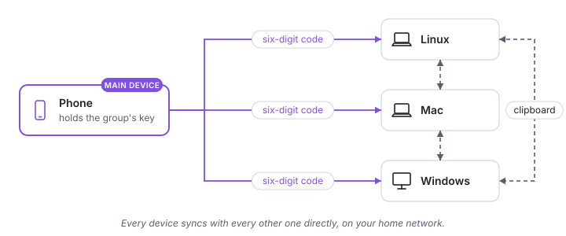

<!-- SPDX-License-Identifier: AGPL-3.0-only -->
# Quick start

For anyone setting up Connect Beyond Borders for the first time with a phone and a computer on a
home network. In four steps, you install the phone app, create a group, add your first computer,
and share your clipboard between them.

Connect Beyond Borders shares one encrypted clipboard across your own devices with no cloud or
account. Your devices form a **group**: a set of devices that trust each other through signed
records instead of a central server. The phone that creates the group is its **main device**
(called *root* in command-line tools): it holds the group's main key and admits new
devices.



If you want to start a group without a phone app (using computers only), follow
[Without the app](without-app.md). If you have phones only, skip steps 2 and 3, tap **+** on the
first phone, and tap **Join a group** on each additional phone to scan its QR code (see
[two kinds of group](how-it-works.md#two-kinds-of-group)).

## 1. Install the app and create a group on your phone

This tutorial uses an Android phone (Android 10 or later). For other phone apps (iPhone, Aurora
OS, and HarmonyOS), see [The apps](apps.md).

1. On your Android phone, download `cbb-X.Y.Z.apk` from the
   [latest GitHub release](https://github.com/HunterEwok/cbb/releases/latest).
2. Open the downloaded file to install Connect Beyond Borders. When Android asks, allow your
   browser or file manager to install apps.
3. Open **CBB** and tap **Create a group**.
4. Confirm with your fingerprint, face, or screen lock when asked. The app creates the group's
   main key inside your phone's security hardware.
5. Save the group's **recovery key**, which the app shows once. Choose **Write on a sheet** to
   print or save it, **Write to YubiKey** to store it on a YubiKey, or both. Store the recovery
   key separately from your devices: it is the only way to move the group to another main device
   if you lose this phone ([Keys and attestation](keys.md)).

**What you see:** After you close the recovery key screen, the app opens **Add a device** with a
QR code and a six-digit pairing code. If you close that screen, the app shows **Home** with your
phone listed as online.

## 2. Install Connect Beyond Borders on a computer

Choose a computer on the same home network as your phone, such as a laptop, a desktop, or a
Raspberry Pi.

- On **Linux** or **macOS**, open a terminal and run:

  ```sh
  curl -fsSL https://github.com/HunterEwok/cbb/releases/latest/download/get.sh | sudo sh
  ```

  On macOS 14 or later, you can also download and open `cbb-X.Y.Z.pkg` from the
  [latest GitHub release](https://github.com/HunterEwok/cbb/releases/latest) to install both the
  background service and the menu bar app.

- On **Windows** 10 (1809 or later) or 11, open PowerShell with **Run as administrator** and run:

  ```powershell
  irm https://github.com/HunterEwok/cbb/releases/latest/download/get.ps1 | iex
  ```

During setup, the installer checks the download's signature, installs the background service
(`cbb`), and asks up to two questions:

1. **Firewall rules** (shown when a firewall is active): answer `y` to let Connect Beyond Borders
   communicate on your home network.
2. **Automatic updates**: answer `y` to let Connect Beyond Borders check daily for signed updates
   and install them automatically.

On Linux, log out and log back in once so your account can run `cbb` without `sudo`. On Windows,
open a new terminal window.

**What you see:** The installer reports that Connect Beyond Borders is running on TCP port 8764
and prints the next command to join a group. For Homebrew, Docker, routers, and other options,
see [Installing](install.md).

## 3. Add the computer to your group

1. On your phone, make sure **Add a device** is open. If you are on **Home**, tap **+** and
   choose **Add a device**. The screen displays a QR code and six digits, and waits for five
   minutes.
2. On your computer, join using a terminal or the desktop app:
   - **In a terminal (Linux and macOS):** run `sudo cbb pair -code`, then type the six digits
     shown on your phone.
   - **In a terminal (Windows):** open a terminal as administrator, run `cbb pair -code`, then
     type the six digits.
   - **In the desktop app (Linux tray app, Windows tray app, or macOS menu bar app):** open
     **CBB**, select **Join a group**, type the six digits, and confirm with your administrator
     password when asked.

**What you see:** Your computer confirms that it joined the group, and the **Add a device** screen
on your phone closes. On your phone's **Home** screen, the computer appears in your device list
and shows as online.

Add any other computers the same way: install Connect Beyond Borders, open **Add a device** on
your phone, and run `cbb pair -code` (or use **Join a group** in the desktop app).

## 4. Copy on one, paste on another

Try copying a line of text on your computer, then paste it on your phone. Then copy text on your
phone and send it to your computer.

- **Between computers:** Copy on one computer and paste on another automatically.
- **Computer to Android:** Copies from your computers arrive on your phone's clipboard
  automatically in the background.
- **Android to computer:** Open **CBB** to send what you copied automatically (if sending fails,
  a **Send what I copied** button appears on **Home**). Without opening the app, you can tap
  **Send** in the CBB notification, tap the **Send clipboard** home-screen widget, share text or
  files to **Connect Beyond Borders**, or turn on **Clipboard sync** in the app's **Settings** to
  send copies automatically.

To pause syncing on a device so its clipboard stays private:

- On your phone, tap the **Sync** button (the house icon) on **Home**—or hold it to pause for
  15 minutes, 1 hour, 8 hours, or until you turn it back on—or tap the **Sync** tile in Android
  Quick Settings.
- On a computer, run `cbb sync off` (and `cbb sync on` to resume), or use the **Sync** switch in
  the desktop app.

For all app features and gestures across platforms, see [The apps](apps.md).

## Recommended next steps

Once your first phone and computer are syncing, consider these two additions:

- **Promote an always-on computer to admin and hub:** If you have a computer that stays on (such
  as a desktop, home server, or Raspberry Pi), open it on **Home** on your main phone and tap
  **Make it an admin**. An admin computer can add and remove devices (`sudo cbb pair` and
  `sudo cbb remove NAME`) when your phone is not at hand. If the computer lacks a hardware
  security chip (TPM or Secure Enclave), its keys live in a file and the app warns you before
  confirming ([Keys and attestation](keys.md#the-three-levels)). You can also make an always-on
  computer your group's **hub** so your devices keep syncing away from home; see
  [Away from home](away-from-home.md).
- **Add a second phone:** Tap **+** on your main phone, then tap **Join a group** on the second
  phone and scan the QR code. The second phone joins as a member. To let it manage devices as
  well, open it on **Home** on your main phone and tap **Make it an admin**. Keep your recovery
  key safe in case you ever need to move the group to another main device
  ([If a device is lost](lost-device.md)).

## What next

- [How it works](how-it-works.md): Understand group roles, encryption, and how devices connect at
  home and away.
- [The apps](apps.md): Explore what the phone, watch, TV, and desktop apps show and do.
- [Away from home](away-from-home.md): Sync your clipboard outside your home network through a
  hub or blind relay.
- [Troubleshooting](troubleshooting.md): Diagnose connection, firewall, and pairing issues.
